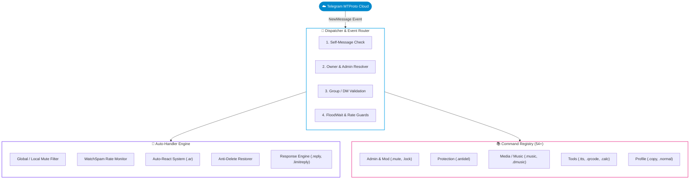

<div align="center">

<!-- ═══════════════ ANIMATED HEADER (Dark + Light theme aware) ═══════════════ -->
<picture>
  <source media="(prefers-color-scheme: dark)" srcset="https://capsule-render.vercel.app/api?type=rect&color=0:0f0c29,50:302b63,100:24243e&height=240&section=header&text=TG-USERBOT-PRO&fontSize=64&fontAlignY=42&animation=twinkling&fontColor=ffffff&desc=Next-Generation%20Asynchronous%20Telegram%20Automation%20Engine&descAlignY=66&descSize=18&descColor=00D2FF">
  <source media="(prefers-color-scheme: light)" srcset="https://capsule-render.vercel.app/api?type=rect&color=0:e0f2fe,50:ede9fe,100:fce7f3&height=240&section=header&text=TG-USERBOT-PRO&fontSize=64&fontAlignY=42&animation=twinkling&fontColor=1e1b4b&desc=Next-Generation%20Asynchronous%20Telegram%20Automation%20Engine&descAlignY=66&descSize=18&descColor=0369a1">
  
</picture>

<!-- ═══════════════ TYPING ANIMATION ═══════════════ -->
<a href="https://github.com/sumaldevservices-alt/TG-UserBot">
  <picture>
    <source media="(prefers-color-scheme: dark)" srcset="https://readme-typing-svg.demolab.com?font=Fira+Code&weight=600&size=22&duration=3000&pause=900&color=00D2FF&center=true&vCenter=true&multiline=false&width=760&height=50&lines=%E2%9A%A1+Production-Ready+Telegram+Userbot;%F0%9F%9A%80+Async+Telethon+%2B+MTProto+Core;%F0%9F%90%B3+Docker+%7C+VPS+%7C+Render+%7C+Railway+%7C+Heroku;%F0%9F%A7%A9+54%2B+Modular+Automation+Commands;%F0%9F%94%92+Zero-Config+Credential+Protection;%F0%9F%92%BB+Built+for+Developers+%26+Power+Users">
    <source media="(prefers-color-scheme: light)" srcset="https://readme-typing-svg.demolab.com?font=Fira+Code&weight=600&size=22&duration=3000&pause=900&color=0369A1&center=true&vCenter=true&multiline=false&width=760&height=50&lines=%E2%9A%A1+Production-Ready+Telegram+Userbot;%F0%9F%9A%80+Async+Telethon+%2B+MTProto+Core;%F0%9F%90%B3+Docker+%7C+VPS+%7C+Render+%7C+Railway+%7C+Heroku;%F0%9F%A7%A9+54%2B+Modular+Automation+Commands;%F0%9F%94%92+Zero-Config+Credential+Protection;%F0%9F%92%BB+Built+for+Developers+%26+Power+Users">
    
  </picture>
</a>

<br/>

<!-- ═══════════════ BADGES ═══════════════ -->


<br/>


<br/><br/>

<!-- ═══════════════ NAV BUTTONS ═══════════════ -->
<a href="#-quick-start"></a>
<a href="#-architecture"></a>
<a href="#-command-catalog"></a>
<a href="#-deployment-matrix"></a>
<a href="#-security--responsible-use"></a>

</div>


## 📑 Table of Contents

<table>
<tr>
<td>

- [✨ Key Highlights](#-key-highlights)
- [🏛️ Architecture](#-architecture)
- [📦 Project Structure](#-project-structure)
- [🧰 Tech Stack](#-tech-stack)
- [⚡ Quick Start](#-quick-start)

</td>
<td>

- [🚢 Deployment Matrix](#-deployment-matrix)
- [📚 Command Catalog](#-command-catalog)
- [🔐 Security & Responsible Use](#-security--responsible-use)
- [❓ FAQ](#-faq)
- [🤝 Contributing](#-contributing)
- [📄 License](#-license)

</td>
</tr>
</table>

---

## ✨ Key Highlights

<table>
  <tr>
    <td width="50%" valign="top">
      <h3>🔒 100% Secret Isolation</h3>
      <p>No tokens, credentials, or sessions are hardcoded. Everything runs on environment variables (12-Factor App design) with startup validation and automatic <code>.env</code> parsing.</p>
    </td>
    <td width="50%" valign="top">
      <h3>🔄 Dual-Session Architecture</h3>
      <p>Run with a local persistent SQLite session, or a stateless in-memory <b>StringSession</b> for ephemeral clouds like Render, Railway and Heroku.</p>
    </td>
  </tr>
  <tr>
    <td width="50%" valign="top">
      <h3>🛡️ Real-Time Self-Defense</h3>
      <p><b>Anti-Delete Protection</b> caches your outgoing messages in a rolling buffer and instantly restores them if they get deleted.</p>
    </td>
    <td width="50%" valign="top">
      <h3>🎧 Studio Audio Converter</h3>
      <p>Built-in <code>yt-dlp</code> + <code>ffmpeg</code> pipeline extracts, converts, tags and sends 320kbps MP3s or native Telegram voice notes.</p>
    </td>
  </tr>
  <tr>
    <td width="50%" valign="top">
      <h3>⚙️ Dynamic Owner Awareness</h3>
      <p>No hardcoded names or usernames. The account holder is identified at boot via the MTProto handshake, and menus are rendered for them automatically.</p>
    </td>
    <td width="50%" valign="top">
      <h3>🌐 Battle-Tested Multi-Platform</h3>
      <p>Ships with Docker Compose, a systemd unit template, a Render blueprint and a Railway manifest, all validated by CI.</p>
    </td>
  </tr>
</table>

<div align="center">

| 🧩 Commands | 🐍 Python | ⚡ Core | 🐳 Deploy Targets | 🔑 Hardcoded Secrets |
|:---:|:---:|:---:|:---:|:---:|
| **54+** | **3.10 – 3.12** | **Async / MTProto** | **5** | **0** |

</div>

---

## 🏛️ Architecture

### 🔀 System Flow



### 🧠 Core Subsystems

| # | Subsystem | What it does |
|:-:|---|---|
| 1️⃣ | **Dispatcher Engine** | Parses the `.` prefix with boundary-safe splitting (`split(maxsplit=1)`) to prevent index crashes. Enforces the hierarchy: **Account Owner** > **Delegated Admins** > **Regular Members**. |
| 2️⃣ | **WatchSpam Engine** | Sliding-window frequency analyzer. If a watched user sends more than *X* messages within *Y* seconds, their messages are deleted on arrival. |
| 3️⃣ | **Anti-Delete Buffer** | Outgoing messages live in an in-memory TTL dictionary (max 300 messages, 2-hour garbage collection). When Telegram fires `MessageDeleted` for one of your messages, it is republished immediately. |
| 4️⃣ | **FastGC Title Rotation** | Adaptive background task that smoothly animates group titles with emoji templates without hitting API rate limits. |

---

## 📦 Project Structure

<details>
<summary><b>📂 Click to expand the full tree</b></summary>

```text
TG-USERBOT-PRO/
├── 📁 .github/
│   └── 📁 workflows/
│       └── 📄 ci.yml               # CI (Python 3.10–3.12 syntax & config validation)
├── 📁 docs/
│   ├── 📄 INSTALLATION.md          # Local setup for Windows, Linux & macOS
│   ├── 📄 VPS.md                   # Ubuntu/Debian systemd daemon guide
│   ├── 📄 DOCKER.md                # Docker & Docker Compose setup
│   └── 📄 TROUBLESHOOTING.md       # 2FA, FloodWait & FFmpeg fixes
├── 📁 scripts/
│   ├── 🐍 generate_session.py      # Interactive StringSession generator
│   └── 📜 start.sh                 # Linux / VPS startup wrapper
├── 🐍 userbot.py                   # Main entry point (54+ commands)
├── 🐳 Dockerfile                   # Multi-stage production image with FFmpeg
├── 🐳 docker-compose.yml           # Production Compose orchestration
├── 📄 Procfile                     # Heroku / Dokku worker declaration
├── 📄 render.yaml                  # Render Blueprint (IaC)
├── 📄 railway.json                 # Railway deployment config
├── 📄 requirements.txt             # Pinned dependencies
├── 🔑 .env.example                 # Environment variables template
├── 🚫 .gitignore                   # Protects credentials & sessions
├── 🚫 .dockerignore                # Docker build context filters
├── 📜 LICENSE                      # MIT License
└── 📘 README.md                    # You are here
```

</details>

---

## 🧰 Tech Stack

<div align="center">

<picture>
  <source media="(prefers-color-scheme: dark)" srcset="https://skillicons.dev/icons?i=python,docker,linux,bash,git,github,githubactions,sqlite&theme=dark">
  <source media="(prefers-color-scheme: light)" srcset="https://skillicons.dev/icons?i=python,docker,linux,bash,git,github,githubactions,sqlite&theme=light">
  
</picture>

<br/>


</div>

---

## ⚡ Quick Start

### 1️⃣ Prerequisites

- 🐍 **Python 3.10, 3.11 or 3.12**
- 🌿 **Git**
- 🎞️ **FFmpeg** (required for audio/music conversion)

### 2️⃣ Get Telegram API Credentials

1. Open **[my.telegram.org](https://my.telegram.org)** and log in with your Telegram account.
2. Click **API development tools**.
3. Create a new application (title and short name can be anything).
4. Save your **`API_ID`** (numeric) and **`API_HASH`** (alphanumeric).
5. Get your numeric user ID (send `/id` to `@userinfobot` or `@MissRose_bot`).

### 3️⃣ Generate a StringSession *(recommended for cloud)*

```bash
python scripts/generate_session.py
```

> [!TIP]
> Enter your `API_ID`, `API_HASH`, phone number and login code to receive your `SESSION_STRING`. Keep it secret, it grants full access to your account.

### 4️⃣ Install & Run

<details open>
<summary><b>🪟 Windows (PowerShell)</b></summary>

```powershell
# 1. Clone the repository
git clone https://github.com/sumaldevservices-alt/TG-UserBot.git

# 2. Enter project folder
cd TG-UserBot

# 3. Create virtual environment
python -m venv venv

# 4. Activate it
.\venv\Scripts\Activate.ps1

# 5. Install dependencies
pip install --upgrade pip
pip install -r requirements.txt

# 6. Configure environment variables
Copy-Item .env.example .env
notepad .env
# Fill in API_ID, API_HASH, OWNER_ID (and SESSION_STRING if generated)

# 7. Start the userbot
python userbot.py
```

</details>

<details>
<summary><b>🐧 Linux / 🍎 macOS</b></summary>

```bash
# 1. Clone the repository
git clone https://github.com/sumaldevservices-alt/TG-UserBot.git

# 2. Enter project directory
cd TG-UserBot

# 3. Install system dependencies (Debian/Ubuntu)
sudo apt update && sudo apt install -y python3 python3-venv python3-pip git ffmpeg

# 4. Create and activate virtual environment
python3 -m venv venv
source venv/bin/activate

# 5. Install dependencies
pip install --upgrade pip
pip install -r requirements.txt

# 6. Configure environment variables
cp .env.example .env
nano .env

# 7. Start the userbot
python3 userbot.py
```

</details>

### 🔑 Environment Variables

| Variable | Required | Description |
|---|:---:|---|
| `API_ID` | ✅ | Numeric API ID from my.telegram.org |
| `API_HASH` | ✅ | API hash from my.telegram.org |
| `OWNER_ID` | ✅ | Your numeric Telegram user ID |
| `SESSION_STRING` | ☁️ Cloud | StringSession for stateless deployments |

---

## 🚢 Deployment Matrix

<div align="center">

| Platform | Difficulty | Auto-Restart | Best For |
|:---:|:---:|:---:|---|
| 🐳 **Docker** | ⭐⭐ | ✅ | Consistent, isolated environments |
| 🖥️ **Linux VPS** | ⭐⭐⭐ | ✅ (systemd) | 24/7 uptime with full control |
| ☁️ **Render** | ⭐ | ✅ | One-click Blueprint worker |
| 🚂 **Railway** | ⭐ | ✅ | Deploy straight from GitHub |
| 🟣 **Heroku / Dokku** | ⭐⭐ | ✅ | Classic Procfile worker |

</div>

<details>
<summary><b>🐳 1. Docker & Docker Compose</b></summary>

<br/>

Running inside Docker guarantees a consistent environment and isolates all dependencies.

```bash
# 1. Prepare configuration
cp .env.example .env
nano .env

# 2. Start container in background
docker compose up -d --build

# 3. Inspect live logs
docker compose logs -f userbot
```

> For standalone Docker commands, see [docs/DOCKER.md](docs/DOCKER.md).

</details>

<details>
<summary><b>🖥️ 2. Linux VPS (systemd Auto-Restart Service)</b></summary>

<br/>

Keep your bot running 24/7 on an Ubuntu/Debian VPS with automatic restarts after reboots or crashes.

**Step 1.** Set up the code in `/home/userbot/TG-UserBot` as documented in [docs/VPS.md](docs/VPS.md).

**Step 2.** Create the unit file `/etc/systemd/system/tg-userbot.service`:

```ini
[Unit]
Description=TG-USERBOT-PRO Background Service
After=network.target

[Service]
Type=simple
User=userbot
WorkingDirectory=/home/userbot/TG-UserBot
EnvironmentFile=/home/userbot/TG-UserBot/.env
ExecStart=/home/userbot/TG-UserBot/venv/bin/python3 /home/userbot/TG-UserBot/userbot.py
Restart=always
RestartSec=10

[Install]
WantedBy=multi-user.target
```

**Step 3.** Enable and start:

```bash
sudo systemctl daemon-reload
sudo systemctl enable --now tg-userbot
sudo journalctl -u tg-userbot -f
```

</details>

<details>
<summary><b>☁️ 3. Render (Worker Blueprint)</b></summary>

<br/>

1. Fork or push this repository to your GitHub account.
2. In the [Render Dashboard](https://dashboard.render.com/), click **New +** → **Blueprint**.
3. Select your repository. Render reads [`render.yaml`](render.yaml) and creates a Background Worker.
4. Set your environment variables: `API_ID`, `API_HASH`, `OWNER_ID`, `SESSION_STRING`.

</details>

<details>
<summary><b>🚂 4. Railway</b></summary>

<br/>

1. In [Railway](https://railway.app/), click **New Project** → **Deploy from GitHub repo**.
2. Select your repository.
3. Railway auto-detects the [`Dockerfile`](Dockerfile) and [`railway.json`](railway.json).
4. Add your environment variables in the **Variables** tab.

</details>

<details>
<summary><b>🟣 5. Heroku / Dokku (Procfile)</b></summary>

<br/>

The repository includes a production [`Procfile`](Procfile) configured as a background worker:

```text
worker: python userbot.py
```

Scale your worker dyno:

```bash
heroku ps:scale worker=1
```

</details>

---

## 📚 Command Catalog

<div align="center">


</div>

> [!NOTE]
> All commands can target users by **replying to their message**, using their **`@username`**, or providing their **numeric ID**.

<details open>
<summary><h3>👑 Administration & Permission Management</h3></summary>

| Command | Syntax | Description | Scope |
|---|---|---|:---:|
| `.menu` | `.menu` | Interactive paginated userbot HUD | 🌐 Global |
| `.menu1` – `.menu5` | `.menu1` | Quick jumps to specific category pages | 🌐 Global |
| `.cmds` | `.cmds` | Complete listing of all 54+ commands | 🌐 Global |
| `.admins` | `.admins` | List all delegated bot administrators | 👑 Owner |
| `.addadmin` | `.addadmin @user` | Grant admin access to control the bot | 👑 Owner |
| `.deladmin` | `.deladmin @user` | Revoke delegated bot admin access | 👑 Owner |
| `.mute` | `.mute @user` | Locally auto-delete user's incoming messages | 🛡️ Admin |
| `.unmute` | `.unmute @user` | Remove local mute on user | 🛡️ Admin |
| `.gmute` | `.gmute @user` | Globally delete user's messages in all chats | 🛡️ Admin |
| `.gunmute` | `.gunmute @user` | Remove global mute | 🛡️ Admin |
| `.mutelist` | `.mutelist` | Display local/global mute & lock panels | 🛡️ Admin |
| `.lock` | `.lock` | Lock group (auto-delete non-admin messages) | 👥 Group |
| `.unlock` | `.unlock` | Unlock group messaging for all participants | 👥 Group |
| `.purge` | `.purge <count>` | Batch delete recent chat messages (1–200) | 👥 Group |
| `.throw` | `.throw @user` | Kick a member from the current group | 👥 Group |
| `.addbots` | `.addbots <count>` | Batch invite bot assistants into the group | 👥 Group |

</details>

<details>
<summary><h3>🛡️ Defense, Protection & Anti-Delete</h3></summary>

| Command | Syntax | Description |
|---|---|---|
| `.antidel` | `.antidel on / off` | Real-time buffer that restores your deleted messages |
| `.watchspam` | `.watchspam @user <limit> <sec>` | Auto-delete target messages exceeding the rate limit (e.g. `3 5`) |
| `.unwatchspam` | `.unwatchspam @user` | Remove WatchSpam restrictions from target |
| `.watchlist` | `.watchlist` | View all active WatchSpam rules in the current chat |
| `.ar` | `.ar <emoji>` | Auto-add an emoji reaction to your outgoing messages |
| `.sar` | `.sar` | Stop active auto-reaction |
| `.fastgc` | `.fastgc set {emoji} <template>` | Live dynamic group title animator |

</details>

<details>
<summary><h3>⚔️ Response Engine & Raid Control</h3></summary>

| Command | Syntax | Description |
|---|---|---|
| `.reply` | `.reply @user` | Start automatic reply loop on target |
| `.sreply` | `.sreply [@user]` | Stop active reply loop (specific user or all) |
| `.rr` | `.rr @user` | Start Reaction + Fun response mode |
| `.srr` | `.srr [@user]` | Stop reaction mode |
| `.flag` | `.flag @user` | Flag wave response mode |
| `.sflag` | `.sflag [@user]` | Stop flag wave |
| `.hrr` | `.hrr @user` | Heart-burst response mode |
| `.shrr` | `.shrr [@user]` | Stop heart mode |
| `.replygod` | `.replygod @user` | High-frequency multi-burst response |
| `.sgod` | `.sgod [@user]` | Stop god mode |
| `.limitreply` | `.limitreply <text> <count>` | Send exactly *N* automated replies to target (alias: `.replymansuri`) |
| `.slimitreply` | `.slimitreply [@user]` | Stop limited-count replies (aliases: `.smansuri`, `.sstop`) |

</details>

<details>
<summary><h3>💣 Custom Spam Engine & Text Storage</h3></summary>

| Command | Syntax | Description |
|---|---|---|
| `.spray` | `.spray <text>` | Continuous message loop |
| `.dspray` | `.dspray` | Immediately abort any active loop in the chat |
| `.addtext` | `.addtext <text>` | Store a message template into a slot |
| `.listtexts` | `.listtexts` | Display all saved message templates |
| `.edittext` | `.edittext <id> <new>` | Update an existing template |
| `.deltext` | `.deltext <id>` | Delete a specific template |
| `.cleartext` | `.cleartext confirm` | Delete all stored templates |
| `.tspray` | `.tspray <id>` | Send a template from a slot index |
| `.rspray` | `.rspray` | Randomly send templates from your pool |
| `.multispray` | `.multispray` | Sequentially cycle templates from your pool |
| `.countspray` | `.countspray <n> <text>` | Send exactly *N* messages, then stop |
| `.spraydelay` | `.spraydelay <seconds>` | Set the interval between messages (0.1s – 60s) |

</details>

<details>
<summary><h3>🎵 Media, High-Res Audio & Music</h3></summary>

| Command | Syntax | Description |
|---|---|---|
| `.music` | `.music <song name>` | Search YouTube, download audio and stream it as a Telegram voice note (`.ogg`) |
| `.dmusic` | `.dmusic <song name>` | Download audio and send a 320kbps MP3 with metadata tags |

</details>

<details>
<summary><h3>🛠️ Utility Tools, QR & Profile Tools</h3></summary>

| Command | Syntax | Description |
|---|---|---|
| `.copy` | `.copy @user` | Clone target profile (first name, last name, bio, avatar) |
| `.normal` | `.normal` | Restore your original profile, bio and avatar |
| `.banner` | `.banner` *(reply to photo)* | Set a custom graphic banner for your `.menu` |
| `.rembanner` | `.rembanner` | Remove the custom menu banner |
| `.tts` | `.tts <text>` | Convert text to a speech audio note |
| `.qrcode` | `.qrcode <text>` | Generate a scannable QR code PNG |
| `.fancy` | `.fancy <text>` | Generate styled decorative font text |
| `.style` | `.style <text>` | Convert text into script font |
| `.emoji` | `.emoji <text>` | Add decorative emoji flair to text |
| `.calc` | `.calc <math>` | Safe arithmetic calculator |
| `.weather` | `.weather <city>` | Live weather forecast report |
| `.ip` | `.ip <ip address>` | Geolocation lookup of an IP address |
| `.short` | `.short <url>` | Create a shortened URL via TinyURL |
| `.info` | `.info @user` | Inspect a detailed Telegram user profile |
| `.notesadd` | `.notesadd <text>` | Save a persistent note |
| `.noteslist` | `.noteslist` | View all saved notes |
| `.notesdelete` | `.notesdelete <id>` | Delete a note by ID |
| `.ping` | `.ping` | Measure latency to Telegram MTProto |
| `.status` | `.status` | Show uptime, admin count and operational state |
| `.flip` | `.flip` | Flip a virtual coin (Heads/Tails) |
| `.dice` | `.dice` | Roll a virtual 6-sided die |

</details>

---

## 🔐 Security & Responsible Use

> [!WARNING]
> Userbots act on your **personal Telegram account**. Misuse (spam, harassment, or breaking Telegram's rules) can get your account **limited or banned**. You are responsible for how you use this software.

| | Principle | Details |
|:-:|---|---|
| 🧑‍💻 | **Authorized personal use** | Designed for personal account management, productivity and chat administration. |
| 📜 | **Platform rules** | Always follow [Telegram's Terms of Service](https://telegram.org/tos). Don't use automation to harass users or violate group rules. |
| ⏱️ | **FloodWait protection** | Automated endpoints back off automatically when Telegram raises `FloodWaitError`. |
| 🔑 | **Credential isolation** | Never commit `.env` or session files. `.gitignore` and `.dockerignore` are preconfigured, and logs are sanitized to prevent secret leakage. |

---

## ❓ FAQ

<details>
<summary><b>💻 Can I deploy this without keeping my computer on?</b></summary>
<br/>
Yes! Host it on an inexpensive Ubuntu/Debian VPS (see <a href="docs/VPS.md">docs/VPS.md</a>) or on Render, Railway or Docker.
</details>

<details>
<summary><b>🤖 What's the difference between a bot token and a userbot?</b></summary>
<br/>
A Telegram Bot runs under <code>@BotFather</code> with restricted permissions. A <b>Userbot</b> runs directly on your personal MTProto account, so it can manage your chats, messages and automation natively.
</details>

<details>
<summary><b>🎵 Why do music commands fail on YouTube tracks?</b></summary>
<br/>
Make sure <code>ffmpeg</code> is installed. In Docker it comes pre-installed. See <a href="docs/TROUBLESHOOTING.md">docs/TROUBLESHOOTING.md</a> for more.
</details>

<details>
<summary><b>🔄 How do I update to the latest code?</b></summary>
<br/>

```bash
git pull origin main
pip install -r requirements.txt --upgrade
```

Then restart the userbot or container.
</details>

---

## 🤝 Contributing

Contributions, feature requests and bug fixes are welcome!

```bash
# 1. Fork the repo, then create your feature branch
git checkout -b feature/AmazingFeature

# 2. Commit your changes
git commit -m "Add AmazingFeature"

# 3. Push to the branch
git push origin feature/AmazingFeature

# 4. Open a Pull Request 🎉
```

---

## ⭐ Star History

<div align="center">

<a href="https://star-history.com/#sumaldevservices-alt/TG-UserBot&Date">
  <picture>
    <source media="(prefers-color-scheme: dark)" srcset="https://api.star-history.com/svg?repos=sumaldevservices-alt/TG-UserBot&type=Date&theme=dark" />
    <source media="(prefers-color-scheme: light)" srcset="https://api.star-history.com/svg?repos=sumaldevservices-alt/TG-UserBot&type=Date" />
    
  </picture>
</a>

<br/><br/>

**If this project helped you, drop a ⭐ — it keeps the project alive!**

</div>

---

## 📄 License

This project is licensed under the **MIT License**. See the [LICENSE](LICENSE) file for details.

- **Repository:** [github.com/sumaldevservices-alt/TG-UserBot](https://github.com/sumaldevservices-alt/TG-UserBot)

<div align="center">

<br/>


</div>
